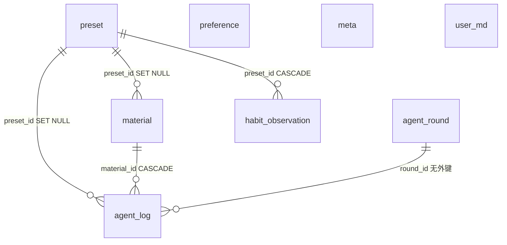

# 分拣匣 Sortbox · 实施契约

> **Spec 版本 4.1-IMPL** ｜ 技术栈：Electron + TypeScript + React ｜ 存储：**SQLite（better-sqlite3）** + **`user.md` 整理习惯**
>
> 本文回答「**怎么做**」。产品行为与验收口径见 **`SPEC.md`**。两份必须一致。
>
> **本文与 `SPEC.md` 冲突时：停下，向人报告冲突点，不要自行取舍。**
> 本文未写到的功能一律不做。MUST 必须实现。MUST NOT 视为缺陷。
>
> **本版明确不做**：整理提案、二次审查、人工指派预设、读取下载文件正文、PDF / Office / 压缩包解析。不得新增这些模块「备用」。`user.md` 只存整理习惯，见 §7.9。

---

## 0. 硬规则

1. **先能跑，再补齐**：按第 19 节顺序做，每个阶段 `pnpm dev` 能起来、`pnpm check` 能过。
2. **不联网、不接大模型、不引账号**。禁用 `fetch` / `http` / `https` / `net` / `axios` / `openai` / `@anthropic-ai/*`。
3. **ViewModel 是纯 TypeScript**：MUST NOT import `react` / `react-dom` / `electron` / `node:*` / `chokidar` / `src/main/**` / `src/renderer/**`。
4. **View 是薄壳**：只做「读 VM 状态 → 画 → 把事件转给 VM」。MUST NOT 直接调 IPC、直接算匹配、直接动文件。
5. **Agent 只移动文件、写日志。** MUST NOT 删除文件内容、MUST NOT 覆盖已存在文件、MUST NOT 修改文件内容。唯一的 `unlink` 见 §10.2（跨盘移动，且必须在目标大小校验通过之后）。
6. **分类先看名字预设，再看 `user.md` 习惯，再看类型预设。** 输入只有文件名、扩展名、大小。MUST NOT 为了分类去读下载文件正文或解析 PDF。三步都空时放入未分类目录。MUST NOT 猜一个预设名，MUST NOT 新建预设。
7. **每一次接受或失败的处理结果 MUST 落一条 `agent_log`**（静默跳过除外，见 §9）。漏记即缺陷。
8. **整理由钩子放行。** Agent 收到文件系统事件时只能 `notifyActivity`，由钩子 `requestRound`。
9. **类名、文件名、常量、枚举落盘字符串、IPC 方法名 MUST 与本文逐字一致。**
10. **`pnpm check` 全绿才算完成。**
11. **数据库只能通过 `src/main/storage/sqlite/**` 访问**，SQL 一律参数化。
12. **运行中 MUST NOT 自己 `INSERT` 预设。** 预设只来自 `completeInitialization`、`savePreset`、导入。`suggestPresetDraft` 只返回草稿，不写库。习惯只能指向已有预设。
13. **试运行 MUST NOT 移动文件，MUST NOT 写 `material` 表，MUST NOT 写 `habit_observation` 或 `user.md`。**
14. **held 文件在自动轮次里 MUST NOT 再次归档**（§11.6）。只有重评或「重新分拣」可以清掉 held。
15. **写 `user.md` 时 MUST NOT 改标记块以外的内容，也 MUST NOT 改不带 `# auto` 的习惯行。** 只允许增删 `# auto` 行，以及追加或裁剪 `sortbox:learned` 区。标记块缺失时可以补一个空块。

---

## 1. 技术栈与依赖锁定

| 用途 | 依赖 | 版本约束 |
| --- | --- | --- |
| 桌面运行时 | `electron` | `^30` |
| 视图 | `react` / `react-dom` | `^18` |
| 语言 | `typescript` | `^5.5` |
| 构建 | `electron-vite` + `vite` | `^2` / `^5` |
| 文件监听 | `chokidar` | `^3.6` |
| 数据库 | `better-sqlite3` | `^11` |
| 运行时校验 | `zod` | `^3` |
| 单元测试 | `vitest` + `@vitest/coverage-v8` | `^2` |
| 代码规范 | `eslint` + `typescript-eslint` + `eslint-plugin-react-hooks` + `prettier` | `^9` / `^8` / `^5` / `^3` |
| 打包 | `electron-builder` | `^25` |
| 类型声明 | `@types/better-sqlite3` | 对应版本 |

**MUST NOT 引入**：ORM、HTTP 客户端、UI 组件库（Ant Design / MUI / Tailwind）、状态管理库（Redux / Zustand / MobX / TanStack Query）、路由库、`pdfjs-dist`、`yauzl`、`mammoth`、`unzipper`、OCR、全文检索。

样式用单文件 CSS（`src/renderer/styles/app.css`），手写。包管理器：`pnpm`，提交 `pnpm-lock.yaml`。

### 1.1 原生模块与打包

```json
{
  "dependencies": { "better-sqlite3": "^11" },
  "devDependencies": { "electron": "^30" },
  "scripts": { "postinstall": "electron-builder install-app-deps" }
}
```

`electron-builder.yml` MUST 含：

```yaml
npmRebuild: true
asarUnpack:
  - "**/node_modules/better-sqlite3/**"
  - "**/*.node"
```

`better-sqlite3` MUST 在 `dependencies`。在哪台机器构建就产出哪个平台的包。首次安装编译原生模块失败时，打印：`原生模块编译失败，请确认已安装 Visual Studio Build Tools / Xcode Command Line Tools`。

### 1.2 库的使用边界

| 库 | 唯一允许 import 的位置 |
| --- | --- |
| `better-sqlite3` | `src/main/storage/sqlite/**` |
| `chokidar` | `src/main/agent/watcher.ts` |

---

## 2. 仓库结构

仓库根目录就是应用根目录。

```
├── package.json
├── pnpm-workspace.yaml
├── pnpm-lock.yaml
├── tsconfig.json
├── tsconfig.node.json
├── tsconfig.web.json
├── electron.vite.config.ts
├── vitest.config.ts
├── eslint.config.js
├── .prettierrc.json
├── electron-builder.yml
├── SPEC.md
├── SPEC-IMPL.md
├── scripts/
│   └── check-boundaries.mjs
├── src/
│   ├── main/
│   │   ├── index.ts
│   │   ├── core/
│   │   │   ├── ServiceContainer.ts
│   │   │   ├── paths.ts
│   │   │   └── logger.ts
│   │   ├── model/
│   │   │   ├── category.ts
│   │   │   └── naming.ts
│   │   ├── storage/
│   │   │   ├── repositories.ts
│   │   │   └── sqlite/
│   │   │       ├── Database.ts
│   │   │       ├── migrations.ts
│   │   │       ├── SqlitePreferenceRepository.ts
│   │   │       ├── SqlitePresetRepository.ts
│   │   │       ├── SqliteMaterialRepository.ts
│   │   │       ├── SqliteAgentLogRepository.ts
│   │   │       ├── SqliteAgentRoundRepository.ts
│   │   │       └── SqliteHabitRepository.ts
│   │   ├── preset/
│   │   │   ├── builtinTemplates.ts
│   │   │   ├── PresetMatcher.ts
│   │   │   ├── TemplatePathResolver.ts
│   │   │   └── PresetTransfer.ts
│   │   ├── userpref/
│   │   │   ├── userMarkdown.ts
│   │   │   ├── evaluateHabits.ts
│   │   │   ├── UserHabitSet.ts
│   │   │   └── HabitLearner.ts
│   │   ├── agent/
│   │   │   ├── AgentService.ts
│   │   │   ├── intake.ts
│   │   │   ├── move.ts
│   │   │   ├── undo.ts
│   │   │   ├── watcher.ts
│   │   │   └── triggers/
│   │   │       ├── TriggerHook.ts
│   │   │       ├── IdleTrigger.ts
│   │   │       ├── ImmediateTrigger.ts
│   │   │       ├── IntervalTrigger.ts
│   │   │       ├── ManualTrigger.ts
│   │   │       └── createTrigger.ts
│   │   ├── system/
│   │   │   ├── shellActions.ts
│   │   │   └── sha256.ts
│   │   └── ipc/
│   │       ├── schema.ts
│   │       ├── handlers.ts
│   │       └── register.ts
│   ├── preload/
│   │   └── index.ts
│   ├── shared/
│   │   ├── types/
│   │   │   ├── domain.ts
│   │   │   ├── api.ts
│   │   │   └── preferences.ts
│   │   ├── navigation/
│   │   │   ├── constants.ts
│   │   │   └── services.ts
│   │   └── viewmodel/
│   │       ├── ViewModelBase.ts
│   │       ├── InitializationViewModel.ts
│   │       ├── MainViewModel.ts
│   │       ├── DashboardViewModel.ts
│   │       ├── UnclassifiedViewModel.ts
│   │       ├── LogViewModel.ts
│   │       ├── QueryViewModel.ts
│   │       ├── PresetListViewModel.ts
│   │       ├── SettingsViewModel.ts
│   │       ├── ResultViewModel.ts
│   │       ├── FileDetailViewModel.ts
│   │       └── PresetDetailViewModel.ts
│   └── renderer/
│       ├── index.html
│       ├── main.tsx
│       ├── AppBootstrap.tsx
│       ├── core/
│       │   ├── ServiceLocator.ts
│       │   ├── ViewLocator.ts
│       │   └── useViewModel.ts
│       ├── api/
│       │   └── IpcSortboxApi.ts
│       ├── views/
│       │   ├── InitializationView.tsx
│       │   ├── MainView.tsx
│       │   ├── DashboardView.tsx
│       │   ├── UnclassifiedView.tsx
│       │   ├── LogView.tsx
│       │   ├── QueryView.tsx
│       │   ├── PresetListView.tsx
│       │   ├── SettingsView.tsx
│       │   ├── ResultView.tsx
│       │   ├── FileDetailView.tsx
│       │   └── PresetDetailView.tsx
│       ├── components/
│       └── styles/
│           └── app.css
└── tests/
    ├── fake/
    │   └── FakeSortboxApi.ts
    └── unit/
        ├── matcher.test.ts
        ├── habitMarkdown.test.ts
        ├── evaluateHabits.test.ts
        ├── habitLearner.test.ts
        ├── pathResolver.test.ts
        ├── category.test.ts
        ├── naming.test.ts
        ├── intake.test.ts
        ├── sqliteRepositories.test.ts
        ├── idleTrigger.test.ts
        ├── immediateTrigger.test.ts
        ├── intervalTrigger.test.ts
        ├── manualTrigger.test.ts
        └── viewmodel/
            ├── dashboardViewModel.test.ts
            ├── unclassifiedViewModel.test.ts
            └── settingsViewModel.test.ts
```

单文件 ≤ 300 行，由 §3.4 强制。`migrations.ts` 放宽到 400 行。超出就拆文件，不要放宽扫描规则。

---

## 3. 编码规约与质量门禁

### 3.1 风格

评阅人是 Java 背景。因此：

- 用 class + interface + 构造器注入。不用高阶函数工厂、闭包装配、装饰器。
- 不写一行流。`map` / `filter` 每步一行，变量用完整名字（`presets`，不要 `ps`）。
- 每个导出成员有一句中文注释，说明职责。
- 常量放文件顶部，`SCREAMING_SNAKE_CASE`。禁止 `enum`，用字符串字面量联合类型。
- 时间参数来自 `Preferences`，不要在钩子里再写一份魔法数字。`TRIGGER_TICK_MS` 例外，它是钩子内部节拍。

### 3.2 TypeScript

`tsconfig.node.json` 与 `tsconfig.web.json` 都要：

```json
{
  "strict": true,
  "noUncheckedIndexedAccess": true,
  "noImplicitOverride": true,
  "noImplicitReturns": true,
  "noFallthroughCasesInSwitch": true,
  "noUnusedLocals": true,
  "noUnusedParameters": true,
  "forceConsistentCasingInFileNames": true,
  "moduleResolution": "bundler",
  "target": "ES2022",
  "skipLibCheck": true
}
```

两份都设 `paths: { "@shared/*": ["src/shared/*"] }`。`tsconfig.web.json` 加 `"jsx": "react-jsx"`。

### 3.3 scripts（名字不可改）

```json
{
  "scripts": {
    "dev": "electron-vite dev",
    "build": "electron-vite build",
    "start": "electron-vite preview",
    "dist": "electron-vite build && electron-builder",
    "typecheck": "tsc -p tsconfig.node.json --noEmit && tsc -p tsconfig.web.json --noEmit",
    "lint": "eslint . --max-warnings 0",
    "test": "vitest run --coverage",
    "check:boundaries": "node scripts/check-boundaries.mjs",
    "check": "pnpm typecheck && pnpm lint && pnpm test && pnpm check:boundaries"
  }
}
```

### 3.4 `scripts/check-boundaries.mjs`

遍历 `src/` 与 `tests/` 下全部 `.ts` / `.tsx`。命中任一条就 `process.exit(1)`，并打印 `文件:行号 → 违规描述`。

| # | 规则 | 匹配 | 豁免 |
| --- | --- | --- | --- |
| B1 | ViewModel 禁止 UI / Node | `src/shared/viewmodel/**` 出现 `from 'react'`、`from 'electron'`、`from 'node:`、`from 'chokidar'`、`from 'better-sqlite3'`、`@main`、`@renderer` | 无 |
| B2 | View 禁止业务 | `src/renderer/views/**` 与 `components/**` 出现 `ipcRenderer`、`window.sortbox`、`fs.`、`AgentService`、`PresetMatcher` | 无 |
| B3 | 进程边界 | `src/main/**` 出现 `@renderer/`；`src/renderer/**` 出现 `@main/` | 无 |
| B4 | 禁止网络 / 模型 | `/\bfetch\s*\(/`、`from 'http'`、`from 'node:http'`、`from 'https'`、`from 'axios'`、`from 'openai'`、`/apiKey/i`、`/api_key/i`、`net.connect` | 无 |
| B5 | 禁止删除 | `unlink`、`unlinkSync`、`rm(`、`rmSync`、`rmdir` | 仅 `src/main/agent/move.ts` 允许 `unlink` / `unlinkSync`。该文件仍禁止 `rm` / `rmdir` |
| B6 | 禁止复制归档 | `copyFile` | 仅 `src/main/agent/move.ts` |
| B7 | 行数 | `.ts` / `.tsx` 超过 300 行 | `migrations.ts` 允许 400 行 |
| B8 | 放弃类型 | `: any`、`<any>`、`as any`（先去掉注释和字符串） | 无 |
| B9 | 数据库泄漏 | `better-sqlite3` | 仅 `src/main/storage/sqlite/**` |
| B10 | 禁止内容解析库 | `pdfjs`、`yauzl`、`mammoth`、`unzipper` | 无 |
| B11 | 监听库泄漏 | `chokidar` | 仅 `src/main/agent/watcher.ts` 与 `src/main/userpref/UserHabitSet.ts` |
| B12 | 禁止读下载文件正文 | `src/main/**` 出现 `readFile` 或 `readFileSync` | 仅 `src/main/userpref/userMarkdown.ts` 可以读写 `user.md`。哈希用 `createReadStream`，且 `createReadStream` 只允许出现在 `src/main/system/sha256.ts` |
| B13 | `user.md` 写回收口 | `writeFile` / `writeFileSync` | 仅 `src/main/userpref/userMarkdown.ts` |

### 3.5 ESLint

- `@typescript-eslint/no-explicit-any: error`
- `@typescript-eslint/no-floating-promises: error`
- `@typescript-eslint/consistent-type-imports: error`
- `@typescript-eslint/explicit-function-return-type: error`
- `react-hooks/rules-of-hooks: error`
- `react-hooks/exhaustive-deps: error`
- `no-console: ["error", { allow: ["warn", "error"] }]`

业务日志走 `logger`，不用 `console.log`。

### 3.6 覆盖率

门槛只打在有单测的纯逻辑上。不要给整个 `viewmodel/` 设目录门槛：11 个 VM 里只要求 3 个有单测，其余是薄编排，整目录门槛会迫使人为凑覆盖率。

```ts
coverage: {
  provider: 'v8',
  reporter: ['text', 'json-summary'],
  thresholds: {
    'src/main/preset/PresetMatcher.ts': { lines: 90, functions: 90 },
    'src/main/preset/TemplatePathResolver.ts': { lines: 90, functions: 90 },
    'src/main/preset/builtinTemplates.ts': { lines: 80 },
    'src/main/agent/triggers/**': { lines: 85, functions: 85 },
    'src/main/agent/intake.ts': { lines: 85 },
    'src/main/model/**': { lines: 90 },
    'src/main/userpref/userMarkdown.ts': { lines: 85 },
    'src/main/userpref/evaluateHabits.ts': { lines: 90 }
  }
}
```

未达门槛则 `pnpm test` 失败。`PresetTransfer.ts` 含系统对话框，不设覆盖率门槛。

---

## 4. 领域类型（`src/shared/types/domain.ts`）

字段名与落盘字符串 MUST 逐字一致。

```ts
export type TriggerPolicy = 'idle' | 'immediate' | 'interval' | 'manual';
export type TriggerReason = 'startup' | 'idle-settled' | 'max-defer' | 'immediate' | 'interval' | 'manual';
export type AgentState = 'stopped' | 'scanning' | 'idle' | 'processing' | 'paused';
export type MaterialStatus = 'unclassified' | 'archived' | 'held';
export type AgentAction = 'archived' | 'unclassified' | 'failed' | 'simulated' | 'skipped';
export type MatchTier = 'name-and-type' | 'name' | 'type' | 'habit' | 'none';
export type HitKind = 'includes' | 'starts' | 'ends' | 'type' | 'none';

export interface Preset {
  id: number;
  name: string;
  extensions: string | null;     // 逗号或中文逗号分隔，无点小写；null 或空 = 不限类型
  nameIncludes: string | null;
  nameStarts: string | null;
  nameEnds: string | null;
  nameExcludes: string | null;
  targetDir: string;
  pathLayout: string;            // 默认 '{yyyy-MM}/{origFileName}'
  priority: number;              // 越小越优先，类型模板 100，名字模板 50
  enabled: boolean;
  maxSizeMb: number;             // 0 = 不限
  createdAt: number;
  updatedAt: number;
}

export interface PresetDraft extends Omit<Preset, 'id' | 'createdAt' | 'updatedAt'> {
  id: number | null;
}

export interface PresetTemplate {
  key: string;
  name: string;
  extensions: string;
  nameIncludes: string | null;
  nameStarts: string | null;
  nameEnds: string | null;
  nameExcludes: string | null;
  pathLayout: string;
  priority: number;
  description: string;
}

export interface Material {
  id: number;
  fileName: string;
  currentPath: string;
  originPath: string | null;
  presetId: number | null;
  category: string | null;
  extension: string;             // 小写无点，可为空串
  sizeBytes: number;
  modifiedAt: number;
  sha256: string | null;
  status: MaterialStatus;
  favorite: boolean;
  createdAt: number;
  updatedAt: number;
  archivedAt: number | null;
}

export interface AgentLog {
  id: number;
  roundId: number;               // 0 = 不属于自动轮次的单文件操作（重新分拣）
  materialId: number | null;
  presetId: number | null;
  action: AgentAction;
  fromPath: string;
  toPath: string | null;
  reason: string;
  trace: string;
  durationMs: number;
  dryRun: boolean;
  createdAt: number;
  undone: boolean;
  undoneAt: number | null;
}

export interface AgentRound {
  id: number;                    // 轮次号 = 开始时的 epoch 毫秒；0 保留给单文件重新分拣，不插入本表
  reason: TriggerReason;
  startedAt: number;
  finishedAt: number;
  scanned: number;
  archived: number;
  unclassified: number;
  failed: number;
  simulated: number;
  skipped: number;
  deferred: number;
}

export interface AgentSnapshot {
  state: AgentState;
  currentFileName: string | null;
  policy: TriggerPolicy;
  idleSettleMs: number;
  activeRoundId: number | null;
  lastActivityAt: number | null;
  watchFolderCount: number;
  dryRun: boolean;
}

export interface AgentStats {
  archivedToday: number;
  archivedTotal: number;
  unclassifiedCount: number;
  heldCount: number;
  failedToday: number;
  lastArchivedAt: number | null;
  lastRoundAt: number | null;
}

export interface MatchResult {
  presetId: number | null;
  tier: MatchTier;
  hitToken: string | null;
  hitKind: HitKind;
  reason: string;
  trace: string;
  candidateCount: number;
}

export type HabitKind = 'token' | 'extension';
export type DecisionSource = 'preset' | 'habit' | 'none';

export interface HabitRule {
  lineNumber: number;
  kind: HabitKind;
  token: string | null;
  extensions: string[];
  presetName: string;
  auto: boolean;
  raw: string;
}

export interface HabitParseError {
  line: number;
  message: string;
}

export interface HabitDocument {
  rules: HabitRule[];
  errors: HabitParseError[];
}

export interface HabitDiagnostics {
  loaded: boolean;
  usedPrevious: boolean;
  path: string;
  ruleCount: number;
  autoRuleCount: number;
  errors: HabitParseError[];
  stalePresetNames: string[];
}

export interface Disposition {
  presetId: number | null;
  source: DecisionSource;
  tier: MatchTier | 'habit';
  hitToken: string | null;
  reason: string;
  trace: string;
}

export interface HabitObservation {
  featureKind: HabitKind;
  featureValue: string;
  presetId: number;
  presetName: string;
  polarity: 'positive' | 'negative';
  hits: number;
  lastSeenAt: number;
}

export interface MaterialView extends Material {
  presetName: string | null;
  reason: string | null;
  inUnclassifiedDir: boolean;
}

export interface MaterialDetail extends MaterialView {
  logs: AgentLogView[];
  duplicates: MaterialView[];
}

export interface AgentLogView extends AgentLog {
  fileName: string | null;
  presetName: string | null;
}

export interface QuerySpec {
  keyword: string | null;
  presetId: number | null;
  category: string | null;
  status: MaterialStatus | null;
  favoriteOnly: boolean;
}

export interface LogQuery {
  action: AgentAction | null;
  from: number | null;
  to: number | null;
  keyword: string | null;
}

export interface InitRequest {
  watchFolders: string[];
  archiveRoot: string;
  unclassifiedDir: string;
  presets: PresetDraft[];
}
```

### 4.1 中文显示名（同文件导出）

| 内部值 | 中文 |
| --- | --- |
| `idle` / `immediate` / `interval` / `manual` | 静默检测 / 立即 / 定时 / 手动 |
| `startup` / `idle-settled` / `max-defer` / `immediate` / `interval` / `manual` | 启动扫描 / 静默到点 / 强制放行 / 文件就绪 / 定时到点 / 手动触发 |
| `stopped` / `scanning` / `idle` / `processing` / `paused` | 未运行 / 扫描中 / 空闲 / 处理中 / 已暂停 |
| `archived` / `unclassified` / `failed` / `simulated` / `skipped` | 已整理 / 未分类 / 失败 / 试运行 / 跳过 |
| `unclassified` / `archived` / `held`（资料状态） | 未分类 / 已归档 / 已撤销 |
| `name-and-type` / `name` / `type` / `habit` / `none` | 名字+类型 / 仅名字 / 仅类型 / 整理习惯 / 无命中 |

界面轮次号为 `0` 时显示 `—`。

---

## 5. 存储层

### 5.1 路径（`src/main/core/paths.ts`）

```ts
export function sortboxDir(): string;     // path.join(app.getPath('userData'), 'sortbox')
export function dbFilePath(): string;     // path.join(sortboxDir(), 'sortbox.db')
export function userMdPath(): string;     // path.join(sortboxDir(), 'user.md')
export function pathKey(p: string): string;
```

`pathKey`：`path.resolve` 之后，Windows 上 `toLowerCase()`，其它平台保持原样。所有「是不是同一路径」的判断都走它。展示给用户的路径保留原始大小写。

应用名 MUST 在 `app.whenReady()` 之前设为英文 `Sortbox`：`package.json` 的 `name` 为 `sortbox`，`electron-builder.yml` 的 `productName` 为 `Sortbox`，`app.setName('Sortbox')`。窗口标题用 `分拣匣 Sortbox`。这样数据库位于：

- Windows：`%APPDATA%\Sortbox\sortbox\sortbox.db`
- macOS：`~/Library/Application Support/Sortbox/sortbox/sortbox.db`
- Linux：`~/.config/Sortbox/sortbox/sortbox.db`

同目录的 `user.md` 是整理习惯的正文。文件不存在时由 `UserHabitSet` 写入下面这份模板，内容原样：

```markdown
# 整理习惯

> 程序只读 sortbox:habits 两个标记之间的行。标记外可以随便写。
> 习惯在没有具体名字预设时生效，用来选一个已经存在的预设。
> 带 # auto 的行是整理过程中学到的，写在手写行下面。程序不会改你写的行。

<!-- sortbox:habits:begin -->
<!-- sortbox:habits:end -->

<!-- sortbox:learned:begin -->
<!-- sortbox:learned:end -->
```

`sortbox/` 若落在任一监视目录、任一预设目标目录或未分类目录之内，在建库之前失败：主窗中文错误 `数据目录与整理目录重叠，请更换监视目录或归档位置`，然后退出。

### 5.2 连接（`Database.ts`）

整个主进程只 `new Database()` 一次，经 `ServiceContainer` 注入。

```ts
db.pragma('journal_mode = WAL');
db.pragma('synchronous = NORMAL');
db.pragma('foreign_keys = ON');
db.pragma('busy_timeout = 5000');
```

迁移：`MIGRATIONS: Array<{ version: number; up(db): void }>`，从 `meta.schema_version` 读版本，每个迁移放在事务里，事务内更新 `schema_version`。当前只有 `version = 1`。

`app.on('will-quit')` 时先 `agent.stop()`，再 `db.close()`。除库文件不存在外，`SQLITE_CORRUPT` 或表结构不符 → 抛 `数据库结构不匹配，请备份后删除库文件再启动`，MUST NOT 删库。

### 5.3 DDL（`version = 1`，原样执行）

```sql
CREATE TABLE IF NOT EXISTS meta (
  key   TEXT PRIMARY KEY,
  value TEXT NOT NULL
);

CREATE TABLE IF NOT EXISTS preference (
  key   TEXT PRIMARY KEY,
  value TEXT NOT NULL
);

CREATE TABLE IF NOT EXISTS preset (
  id             INTEGER PRIMARY KEY AUTOINCREMENT,
  name           TEXT    NOT NULL,
  extensions     TEXT,
  name_includes  TEXT,
  name_starts    TEXT,
  name_ends      TEXT,
  name_excludes  TEXT,
  target_dir     TEXT    NOT NULL,
  path_layout    TEXT    NOT NULL,
  priority       INTEGER NOT NULL DEFAULT 100,
  enabled        INTEGER NOT NULL DEFAULT 1,
  max_size_mb    INTEGER NOT NULL DEFAULT 0,
  created_at     INTEGER NOT NULL,
  updated_at     INTEGER NOT NULL
);

CREATE TABLE IF NOT EXISTS material (
  id           INTEGER PRIMARY KEY AUTOINCREMENT,
  file_name    TEXT    NOT NULL,
  current_path TEXT    NOT NULL,
  path_key     TEXT    NOT NULL UNIQUE,
  origin_path  TEXT,
  preset_id    INTEGER REFERENCES preset(id) ON DELETE SET NULL,
  category     TEXT,
  extension    TEXT    NOT NULL DEFAULT '',
  size_bytes   INTEGER NOT NULL,
  modified_at  INTEGER NOT NULL,
  sha256       TEXT,
  status       TEXT    NOT NULL CHECK (status IN ('unclassified', 'archived', 'held')),
  favorite     INTEGER NOT NULL DEFAULT 0,
  created_at   INTEGER NOT NULL,
  updated_at   INTEGER NOT NULL,
  archived_at  INTEGER
);

CREATE TABLE IF NOT EXISTS agent_round (
  id            INTEGER PRIMARY KEY,
  reason        TEXT    NOT NULL,
  started_at    INTEGER NOT NULL,
  finished_at   INTEGER NOT NULL,
  scanned       INTEGER NOT NULL DEFAULT 0,
  archived      INTEGER NOT NULL DEFAULT 0,
  unclassified  INTEGER NOT NULL DEFAULT 0,
  failed        INTEGER NOT NULL DEFAULT 0,
  simulated     INTEGER NOT NULL DEFAULT 0,
  skipped       INTEGER NOT NULL DEFAULT 0,
  deferred      INTEGER NOT NULL DEFAULT 0
);

CREATE TABLE IF NOT EXISTS agent_log (
  id          INTEGER PRIMARY KEY AUTOINCREMENT,
  round_id    INTEGER NOT NULL,
  material_id INTEGER REFERENCES material(id) ON DELETE CASCADE,
  preset_id   INTEGER REFERENCES preset(id) ON DELETE SET NULL,
  action      TEXT    NOT NULL CHECK (action IN ('archived','unclassified','failed','simulated','skipped')),
  from_path   TEXT    NOT NULL,
  to_path     TEXT,
  reason      TEXT    NOT NULL,
  trace       TEXT    NOT NULL DEFAULT '',
  duration_ms INTEGER NOT NULL DEFAULT 0,
  dry_run     INTEGER NOT NULL DEFAULT 0,
  created_at  INTEGER NOT NULL,
  undone      INTEGER NOT NULL DEFAULT 0,
  undone_at   INTEGER
);

CREATE INDEX IF NOT EXISTS idx_material_status        ON material(status);
CREATE INDEX IF NOT EXISTS idx_material_unclassified  ON material(status, updated_at DESC);
CREATE INDEX IF NOT EXISTS idx_material_preset        ON material(preset_id, status);
CREATE INDEX IF NOT EXISTS idx_material_sha           ON material(sha256);
CREATE INDEX IF NOT EXISTS idx_log_round              ON agent_log(round_id);
CREATE INDEX IF NOT EXISTS idx_log_material           ON agent_log(material_id);
CREATE INDEX IF NOT EXISTS idx_log_created            ON agent_log(created_at);
CREATE INDEX IF NOT EXISTS idx_log_undoable           ON agent_log(action, undone);

CREATE TABLE IF NOT EXISTS habit_observation (
  id            INTEGER PRIMARY KEY AUTOINCREMENT,
  feature_kind  TEXT    NOT NULL CHECK (feature_kind IN ('token', 'extension')),
  feature_value TEXT    NOT NULL,
  preset_id     INTEGER NOT NULL REFERENCES preset(id) ON DELETE CASCADE,
  polarity      TEXT    NOT NULL CHECK (polarity IN ('positive', 'negative')),
  hits          INTEGER NOT NULL DEFAULT 0,
  last_seen_at  INTEGER NOT NULL,
  UNIQUE (feature_kind, feature_value, preset_id, polarity)
);

CREATE INDEX IF NOT EXISTS idx_habit_preset ON habit_observation(preset_id);
```

插入 `meta.schema_version = '1'`。

### 5.4 关系



`user_md` 不在数据库里。习惯正文以 `user.md` 为唯一真源。

| 关系 | 删除行为 | 说明 |
| --- | --- | --- |
| `preset` → `material` | `SET NULL` | 删预设前若仍有 `archived` 资料，服务层先拒绝。外键是兜底 |
| `preset` → `agent_log` | `SET NULL` | 历史日志保留 |
| `preset` → `habit_observation` | `CASCADE` | 预设没了，为它记的次数一并删除。`user.md` 里指向这个名字的行变为失效，不由数据库删除 |
| `material` → `agent_log` | `CASCADE` | 本项目不删 material 行 |
| `agent_round` → `agent_log` | 无外键 | 轮次号用 epoch 毫秒，查询走 `idx_log_round` |

`path_key` 单独一列：`current_path` 保留大小写，查重用 `WHERE path_key = ?`。改路径时两列一起写。

报告里要写出三条索引用途：

- `idx_material_unclassified`：未分类页按状态过滤并按时间倒序
- `idx_log_undoable`：撤销最近一次
- `idx_material_preset`：预设列表上的已归档数量
- `idx_habit_preset`：删除预设时清理学习次数，以及设置页列出某个预设的观测

### 5.5 Preferences（`src/shared/types/preferences.ts`）

库表是 KV：一行一个字段，值为 `JSON.stringify`。缺字段或类型不符 → 用默认值并 `logger.warn`。

```ts
export interface Preferences {
  initialized: boolean;
  watchFolders: string[];
  ignoreExtensions: string[];
  agentEnabled: boolean;
  agentDryRun: boolean;
  triggerPolicy: TriggerPolicy;
  idleSettleMs: number;
  maxDeferMs: number;
  intervalMs: number;
  intervalFallbackMs: number;
  stabilityWindowMs: number;
  unclassifiedDir: string;
  archiveRoot: string;
}

export const DEFAULT_PREFERENCES: Preferences = {
  initialized: false,
  watchFolders: [],
  ignoreExtensions: ['exe', 'msi', 'dmg', 'iso', 'crdownload', 'part', 'tmp', 'download', 'bak'],
  agentEnabled: true,
  agentDryRun: false,
  triggerPolicy: 'idle',
  idleSettleMs: 3000,
  maxDeferMs: 30000,
  intervalMs: 300000,
  intervalFallbackMs: 0,
  stabilityWindowMs: 800,
  unclassifiedDir: '',
  archiveRoot: ''
};
```

保存时的数值范围：`idleSettleMs` 500–60000；`maxDeferMs` 1000–600000；`intervalMs` 5000–3600000；`intervalFallbackMs` 0 或 5000–86400000；`stabilityWindowMs` 200–5000。

### 5.6 仓储接口（`repositories.ts`）

接口用 `Promise`。实现内部是同步的 better-sqlite3，不要包 `setTimeout`。

```ts
export interface PreferenceRepository {
  load(): Promise<Preferences>;
  save(patch: Partial<Preferences>): Promise<Preferences>;
}

export interface PresetRepository {
  list(): Promise<Preset[]>;
  listEnabled(): Promise<Preset[]>;
  getById(id: number): Promise<Preset | null>;
  save(draft: PresetDraft): Promise<Preset>;
  delete(id: number): Promise<void>;
  setEnabled(id: number, enabled: boolean): Promise<void>;
  countArchived(id: number): Promise<number>;
}

export interface MaterialRepository {
  getById(id: number): Promise<Material | null>;
  getByPathKey(pathKey: string): Promise<Material | null>;
  listByStatus(status: MaterialStatus): Promise<Material[]>;
  query(spec: QuerySpec): Promise<Material[]>;
  upsertSeen(input: {
    fileName: string; currentPath: string; pathKey: string;
    originPath: string; extension: string; sizeBytes: number; modifiedAt: number;
  }): Promise<Material>;
  markArchived(id: number, patch: {
    presetId: number; currentPath: string; pathKey: string;
    category: string; archivedAt: number; fileName: string;
  }): Promise<void>;
  markUnclassified(id: number, patch: {
    currentPath: string; pathKey: string; category: string; fileName: string;
  }): Promise<void>;
  markHeld(id: number, patch: { currentPath: string; pathKey: string; fileName: string }): Promise<void>;
  touchSeen(id: number, patch: { sizeBytes: number; modifiedAt: number }): Promise<void>;
  setFavorite(id: number, favorite: boolean): Promise<void>;
  setSha256(id: number, sha256: string): Promise<void>;
  findDuplicates(sha256: string, excludeId: number): Promise<Material[]>;
  countByStatus(status: MaterialStatus): Promise<number>;
}

export interface AgentLogRepository {
  append(log: Omit<AgentLog, 'id'>): Promise<AgentLog>;
  getById(id: number): Promise<AgentLog | null>;
  listRecent(limit: number): Promise<AgentLogView[]>;
  listByMaterial(materialId: number): Promise<AgentLogView[]>;
  query(query: LogQuery): Promise<AgentLogView[]>;
  findLatestUndoableArchive(): Promise<AgentLog | null>;
  latestByMaterial(materialId: number): Promise<AgentLog | null>;
  markUndone(id: number, undoneAt: number): Promise<void>;
  countByActionSince(action: AgentAction, sinceMs: number): Promise<number>;
}

export interface AgentRoundRepository {
  append(round: AgentRound): Promise<void>;
  latest(): Promise<AgentRound | null>;
}

export interface HabitRepository {
  record(input: {
    featureKind: HabitKind;
    featureValue: string;
    presetId: number;
    polarity: 'positive' | 'negative';
    at: number;
  }): Promise<void>;
  listAll(): Promise<HabitObservation[]>;
  listPromotable(threshold: number): Promise<HabitObservation[]>;
  listDemotable(threshold: number): Promise<HabitObservation[]>;
}
```

`markUnclassified` 与 `markHeld` MUST 把 `preset_id` 置 NULL，`archived_at` 置 NULL。`upsertSeen` 插入时 `status = 'unclassified'`，`preset_id` NULL。已存在则只更新 `size_bytes`、`modified_at`、`file_name`、`updated_at`，不改状态。

`markArchived` + `append` 日志、`markUnclassified` + `append` 日志，MUST 包在同一个 `db.transaction()` 里。文件移动发生在事务之外：先移动成功，再开事务写库。移动成功但写库失败时，MUST NOT 把文件移回去碰运气；记 `logger.error`，下次启动扫描按 `path_key` 补行。这一条要在报告的难点里可以写。

### 5.7 查询

全部参数化。`keyword` 里的 `%` 和 `_` 用 `ESCAPE '\'`。

```sql
SELECT * FROM material
 WHERE status IN ('unclassified', 'held')
 ORDER BY updated_at DESC
 LIMIT 1000;

SELECT * FROM material
 WHERE 1 = 1
   AND (:keyword IS NULL OR file_name LIKE :keyword ESCAPE '\')
   AND (:presetId IS NULL OR preset_id = :presetId)
   AND (:category IS NULL OR category = :category)
   AND (:status IS NULL OR status = :status)
   AND (:favoriteOnly = 0 OR favorite = 1)
 ORDER BY COALESCE(archived_at, updated_at) DESC
 LIMIT 2000;

SELECT * FROM agent_log
 WHERE action = 'archived' AND undone = 0
 ORDER BY id DESC LIMIT 1;

SELECT COUNT(*) AS n FROM agent_log
 WHERE action = 'archived' AND dry_run = 0 AND created_at >= ?;

SELECT COUNT(*) AS n FROM material WHERE preset_id = ? AND status = 'archived';
```

查询一律带 `LIMIT`。不要 `SELECT *` 再在 JS 里滤掉大量行。

### 5.8 日志

`logger.info/warn/error(message, context?)` 输出 `[sortbox][level] message`。不写日志文件。

---

## 6. 整理钩子

### 6.1 接口（`TriggerHook.ts`）

```ts
export const TRIGGER_TICK_MS = 250;

export interface TriggerContext {
  requestRound(reason: TriggerReason): void;
  hasCandidates(): boolean;
  isAgentIdle(): boolean;
  now(): number;
}

export interface TriggerHook {
  readonly policy: TriggerPolicy;
  start(ctx: TriggerContext): void;
  stop(): void;
  notifyActivity(folder: string, at: number): void;
}

export function createTrigger(policy: TriggerPolicy, timing: {
  idleSettleMs: number; maxDeferMs: number; intervalMs: number;
  intervalFallbackMs: number; stabilityWindowMs: number;
}): TriggerHook;
```

### 6.2 `IdleTrigger`

字段：`lastActivityAt`、`firstCandidateAt: number | null`、`timer`。

```
start: lastActivityAt = now；firstCandidateAt = null；每 TRIGGER_TICK_MS 调用 evaluate
stop: 清 timer
notifyActivity: lastActivityAt = max(lastActivityAt, at)
evaluate:
  非 idle → return（不重置）
  无候选 → firstCandidateAt = null；return
  firstCandidateAt 为空 → 设为 now
  now - lastActivityAt >= idleSettleMs → 重置并 requestRound('idle-settled')
  now - firstCandidateAt >= maxDeferMs → 重置并 requestRound('max-defer')
reset: firstCandidateAt = null；lastActivityAt = now
```

`notifyActivity` MUST NOT 直接 `requestRound`。`firstCandidateAt` 只在候选从无到有时置位，持续写入不会推迟强制放行。多个监视目录共用一条活动时间线。

### 6.3 `ImmediateTrigger`

`notifyActivity` 把 `pending` 设为 true，并 `setTimeout(evaluate, stabilityWindowMs + 100)`。evaluate 时若 Agent 非 idle，250ms 后再试。idle 且有候选 → `pending = false` 并 `requestRound('immediate')`。

### 6.4 `IntervalTrigger`

`setInterval(evaluate, intervalMs)`。`notifyActivity` 空实现。idle 且有候选 → `requestRound('interval')`。

### 6.5 `ManualTrigger`

`start` / `stop` / `notifyActivity` 都空实现，不注册定时器。`runNow()` 直接 `requestRound('manual')`。

### 6.6 兜底间隔

`intervalFallbackMs > 0` 时，`AgentService` 另起一个定时器。到点且 idle、有候选、距上一轮开始已超过该间隔 → `requestRound('interval')`。默认 0，关闭。

### 6.7 钩子禁止

MUST NOT 读写数据库、动文件、算匹配、在 `notifyActivity` 里做哈希。`hasCandidates` 只允许列目录和看名称、扩展名、大小、mtime。

### 6.8 热切换

`savePreferences` 改了策略或任一时间参数后，200ms 内停掉旧钩子，用新参数 `createTrigger` + `start`，并发出 `agent.state`。

---

## 7. 预设匹配（`PresetMatcher.ts`）

### 7.0 签名

```ts
export function matchPreset(input: {
  fileName: string;
  sizeBytes: number;
  extension: string;
}, presets: Preset[]): MatchResult;
```

MUST 是纯函数：不读磁盘、不读时钟、不读全局状态。

```ts
export function norm(s: string): string;          // NFC，trim，toLowerCase()（不带 locale）
export function splitTerms(raw: string | null): string[];
```

`splitTerms`：按 `,` 和 `，` 切开，trim，去空，`norm`，码点数 `< 2` 的丢掉。丢掉时不抛异常。调用方保存预设时会提前拒绝过短片段（§12.4），匹配器这里再丢一次，避免脏数据命中一切。

### 7.1 硬淘汰

| 编号 | 规则 |
| --- | --- |
| H1 | `enabled === true` |
| H2 | `extensions` 经 `splitTerms` 后非空 → `extension` 必须在其中。空 → 不限类型 |
| H3 | `nameExcludes` 任一片段是 `norm(fileName)` 的子串 → 淘汰 |
| H4 | `maxSizeMb > 0` 且 `sizeBytes > maxSizeMb * 1024 * 1024` → 淘汰 |

`candidateCount` = 通过 H1–H4 的预设个数。

### 7.2 名字是否命中

主文件名 `stem`：最后一个 `.` 之后是扩展名；`.` 在首位则视为没有扩展名，`stem` 就是整个文件名。

| 字段 | 命中 |
| --- | --- |
| `nameIncludes` | `norm(片段)` 是 `norm(fileName)` 的子串 |
| `nameStarts` | `norm(stem)` 以 `norm(片段)` 开头 |
| `nameEnds` | `norm(stem)` 以 `norm(片段)` 结尾 |

三个正向字段是**或**。命中的片段里，取码点数最多的作为 `hitToken`。长度相同：`includes` 优先于 `starts`，`starts` 优先于 `ends`；种类也相同则取字典序最小的片段。

「有正向名字条件」= 三个字段 `splitTerms` 之后至少还剩一个片段。

### 7.3 三层

只在通过硬淘汰的预设里分层。低层优先，取第一个非空层。

| 层 | `tier` | 条件 |
| --- | --- | --- |
| 1 | `name-and-type` | 有正向名字条件，且 `extensions` 非空，且名字命中 |
| 2 | `name` | 有正向名字条件，且 `extensions` 为空，且名字命中 |
| 3 | `type` | 没有正向名字条件，且 `extensions` 非空 |

有名字条件但这次名字没中的预设，**不进入第 3 层**。它已经算进 `candidateCount`，但不会被选中。

### 7.4 层内排序

1. `priority` 更小优先
2. `hitToken` 码点数更多优先（第 3 层恒为 0）
3. `id` 更小优先

预览时尚未保存的草稿使用 `id = -1`，因此同优先级、同长度时输给已有预设。

### 7.5 `reason` 模板（一字不改）

| 情形 | 原文 |
| --- | --- |
| 层 1，includes | `文件名含「{token}」且类型 .{ext} → 预设「{name}」` |
| 层 1，starts | `文件名以「{token}」开头且类型 .{ext} → 预设「{name}」` |
| 层 1，ends | `文件名以「{token}」结尾且类型 .{ext} → 预设「{name}」` |
| 层 2，includes | `文件名含「{token}」→ 预设「{name}」` |
| 层 2，starts | `文件名以「{token}」开头 → 预设「{name}」` |
| 层 2，ends | `文件名以「{token}」结尾 → 预设「{name}」` |
| 层 3 | `类型 .{ext} 由预设「{name}」接收` |
| 该层候选数 > 1 | 上述文本后追加 `（同层 {n} 个候选，按优先级/命中长度/id 选定）` |
| 无命中 | `无预设命中` |

`{ext}` 用小写无点。无扩展名时层 3 的 `{ext}` 仍写入空串：`类型 . 由预设「{name}」接收` 不会出现，因为空扩展名进不了非空扩展名列表。无扩展名只能命中「不限类型」的名字预设，或落入未分类。

### 7.6 `trace` 模板

命中：

```
候选 {n} 个 | 命中层 {tier} | 选中 preset#{id}「{name}」 | 命中「{token}」({len} 字) | 优先级 {priority}
```

层 3 的 token 段写成 `命中「」(0 字)`。

未命中：`候选 {n} 个 | 无预设命中`。

### 7.7 从文件名建议一条草稿（纯函数，`naming.ts`）

```ts
export function suggestNameToken(fileName: string): string | null;
```

1. 取 `stem`，做 NFC。
2. 用 §8.3 的日期正则把日期换成空格。
3. 用 Unicode 字母切词（`\p{L}+`）。
4. 丢掉码点数 `< 2` 或 `> 20` 的词。
5. 丢掉与下列完全相等的词（比较前 `norm`）：`final`、`copy`、`副本`、`新建`。
6. 取最长的；长度相同取在 `stem` 里更靠前的。
7. 一个都不剩 → `null`。

`suggestPresetDraft(fileName, extension, archiveRoot, existingTargetDirs, unclassifiedDir)` 返回 `PresetDraft`：

- `name` 与 `nameIncludes` = token；token 为 null 时 `name = ''`、`nameIncludes = null`，调用方必须让人填
- `extensions` = 该文件扩展名；空扩展名则 `extensions = null`
- `nameStarts` / `nameEnds` / `nameExcludes` = null
- `priority` = 40
- `pathLayout` = `{yyyy-MM}/{origFileName}`
- `enabled` = true，`maxSizeMb` = 0，`id` = null
- `targetDir`：已有预设目标目录的共同父目录 + `/` + token。没有共同父目录时用 `dirname(unclassifiedDir)` + `/` + token。结果与监视目录、未分类目录、已有目标目录重叠，或 token 为 null → `targetDir = ''`

这个函数 MUST NOT 写数据库、MUST NOT `mkdir`。

### 7.8 内置模板（`builtinTemplates.ts`）

`listBuiltinTemplates(): PresetTemplate[]` 固定 8 条，`pathLayout` 都是 `{yyyy-MM}/{origFileName}`。

| key | name | extensions | nameIncludes | priority |
| --- | --- | --- | --- | --- |
| `doc` | 文档 | `pdf,doc,docx,ppt,pptx,xls,xlsx,txt,md` | 无 | 100 |
| `image` | 图片 | `png,jpg,jpeg,gif,webp,bmp,svg` | 无 | 100 |
| `audio` | 音频 | `mp3,wav,flac,aac,m4a,ogg` | 无 | 100 |
| `video` | 视频 | `mp4,mkv,avi,mov,wmv` | 无 | 100 |
| `archive` | 压缩包 | `zip,rar,7z,tar,gz` | 无 | 100 |
| `code` | 代码 | `java,py,c,cpp,h,js,ts,ipynb,html,css,json` | 无 | 100 |
| `invoice` | 发票 | `pdf,png,jpg,jpeg` | `发票,invoice` | 50 |
| `resume` | 简历 | `pdf,doc,docx` | `简历,resume,cv` | 50 |

`nameStarts`、`nameEnds`、`nameExcludes` 都是 null。描述各用一句中文，例如文档写 `按扩展名收入文档`，发票写 `文件名含发票且是 pdf 或图片`。

初始化勾选后，`targetDir = path.join(archiveRoot, template.name)`。名称已存在的预设不重复创建。

### 7.9 整理习惯（`src/main/userpref/`）

习惯正文只在 `user.md`。`habit_observation` 只存次数。判定是纯函数，不读磁盘。

#### 7.9.1 解析（`userMarkdown.ts`）

```ts
export function parseHabitDocument(text: string): HabitDocument;
export function renderAutoUpdate(text: string, change: {
  add: Array<{ token: string; presetName: string }>;
  remove: Array<{ token: string; presetName: string }>;
  learnedLines: string[];
}): string;
```

- 同时接受 `\n` 和 `\r\n`。写回时沿用读到的换行。剥掉 BOM，写回时不添加 BOM。
- 只解析 `<!-- sortbox:habits:begin -->` 与 `<!-- sortbox:habits:end -->` 之间的非空行。
- 行尾注释：引号之外的 ` #` 起算。`# auto` 单独识别，`auto` 置 true。
- 合法行两种，动作词必须是 `习惯`：
  - `习惯  文件名含 "片段"  -> 预设名`
  - `习惯  扩展名 a, b  -> 预设名`
- 片段经 `norm` 后码点数 `< 2` → 该行进入 `errors`，整份 `rules` 视为无效（调用方沿用上一份）。
- 少引号、缺少 `->`、扩展名为空、预设名为空 → 同样整份无效，`errors` 带行号。
- `renderAutoUpdate` 只替换习惯块里的 `# auto` 行和学习块内容。块外字节不变。自动行追加在习惯块末尾。学习块保留最近 50 条。习惯块或学习块缺失时，在文件末尾补上对应的一对标记。
- 已有相同 `token + presetName` 的 `# auto` 行不重复追加。手写行即使语义相同也不改、不删。

#### 7.9.2 判定（`evaluateHabits.ts`）

```ts
export function decideDisposition(input: {
  fileName: string;
  extension: string;
  sizeBytes: number;
  match: MatchResult;
  habits: HabitRule[];
  presets: Preset[];
}): Disposition;
```

顺序：

1. `match.tier` 为 `name-and-type` 或 `name` → `source='preset'`，reason / trace 用匹配器原文，并在 trace 末尾加 ` | 习惯 未使用`。
2. 否则按 `habits` 数组顺序找第一条可用习惯：
   - `token`：`norm(token)` 是 `norm(fileName)` 的子串。
   - `extension`：`extension` 在 `extensions` 里。
   - `presetName` 对应某条 `enabled` 预设；同名多条时取 id 最小。找不到 → 记入诊断的失效名字，试下一条。
   - 该预设的排除词命中文件名，或 `maxSizeMb` 挡住 → 试下一条。**不检查**预设的扩展名列表。
   - 命中 → `source='habit'`，`tier='habit'`，`presetId` 为该预设。
3. 习惯没有，且 `match.tier === 'type'` → `source='preset'`，沿用类型预设的 reason。
4. 否则 `source='none'`，`presetId=null`，reason 为 `无预设命中`。

习惯 reason 模板一字不改：

| 种类 | 原文 |
| --- | --- |
| token | `无具体名字预设，按整理习惯归入预设「{name}」：文件名含「{token}」` |
| extension | `无具体名字预设，按整理习惯归入预设「{name}」：扩展名 .{ext}` |

trace 在匹配器 trace 后追加 ` | 习惯 {hand|auto} 行{line} → preset#{id}`。手写行是 `hand`，`# auto` 是 `auto`。

#### 7.9.3 加载（`UserHabitSet.ts`）

- 启动时若文件不存在，写入 §5.1 的模板。
- `chokidar` 监听该文件，300ms 防抖后重新解析。
- 解析出 `errors.length > 0` 时不替换内存中的上一份有效 `rules`，`diagnostics.loaded=false`、`usedPrevious=true`。
- 暴露 `current(): HabitRule[]` 与 `diagnostics(): HabitDiagnostics`。
- 自己写回后的 300ms 内忽略由此触发的 change，避免写完又读、再写。

#### 7.9.4 学习（`HabitLearner.ts`）

```ts
export const HABIT_PROMOTE_THRESHOLD = 2;
export const HABIT_DEMOTE_THRESHOLD = 2;
export const HABIT_AUTO_LIMIT = 50;
```

只在**非试运行**、且 `Disposition.source === 'preset'`、且 `tier` 为 `name-and-type` 或 `name`、且 `hitToken` 非空时调用 `observeArchive(token, presetId)`。每个这样的文件记一次 `positive`。类型预设归档和习惯归档都不记。

撤销一条 `action=archived` 的日志时：从该日志 `trace` 解析 `命中层` 和 `命中「…」`。层是 `name-and-type` 或 `name` 且片段非空 → `observeUndo(token, presetId)` 记一次 `negative`。类型层撤销不记文件名习惯。

`reconcile()` 在每轮 `runRound` 结束时调用一次，也在撤销完成后调用一次：

1. 重新读盘上的 `user.md`。解析失败则 `logger.warn` 并返回，不写。
2. `positive >= 2` 且同一 `(token, preset)` 的 `negative == 0`，预设仍存在且启用，自动行未满 50，且文件里还没有这条 `# auto` → 追加 `习惯  文件名含 "{token}"  -> {预设名}          # auto`。学习记录加一行：`{日期时间}  「文件名含 {token}」→「{预设名}」第 {n} 次得到证实，已写入习惯`。
3. `negative >= 2` → 删除对应 `# auto` 行。学习记录写 `已移除`。手写行即使文字相同也不删。
4. 用 `renderAutoUpdate` 原子写回（先写临时文件再 `rename` 覆盖）。
5. 整个方法包 try/catch，失败只 `logger.warn`，不影响已经完成的文件移动。

`{token}` 写入文件时使用观测里保存的 `norm` 后片段。预设名用当前预设的 `name`。

---

## 8. 路径、分类、唯一名

### 8.0 `resolveArchivePath`

```ts
export function resolveArchivePath(input: {
  preset: Preset;
  sourceFileName: string;
  archiveDate: Date;
}): string;
```

1. 替换占位符。结果空或只剩分隔符 → `其他/{origFileName}`。
2. `/` 与 `\` 都当成分隔符，再按 `path.sep` 拼接。
3. 每段去掉 `<>:"|?*` 和控制字符（换成 `_`）。命中 Windows 保留名（`CON` `PRN` `AUX` `NUL` `COM1`–`COM9` `LPT1`–`LPT9`，大小写不敏感，含 `CON.txt` 这种）→ 前面加 `_`。
4. `path.resolve(preset.targetDir, ...segments)`。
5. 结果必须以 `targetDir` 为前缀。出现 `..` 越界 → 抛 `FileActionError('归档路径越界')`。

不创建目录。目录在 `moveFile` 里 `mkdir`。

### 8.1 占位符

| 占位符 | 值 |
| --- | --- |
| `{origFileName}` | 源文件名 |
| `{stem}` | 主文件名 |
| `{ext}` | 小写无点扩展名 |
| `{category}` | §8.2 |
| `{yyyy}` `{MM}` `{dd}` `{yyyy-MM}` `{yyyy-MM-dd}` | `archiveDate` 的本地日期，月日补零 |
| `{fileDate}` | `extractFileDateFromName`；没有则用归档当天的 `yyyy-MM-dd` |
| `{preset}` | 预设名，做与路径段相同的清洗 |

未识别的 `{xxx}` 原样保留。

### 8.2 分类（`category.ts`）

返回值只能是：`文档`、`图片`、`音频`、`视频`、`压缩包`、`代码`、`其他`。

| 返回 | 扩展名 |
| --- | --- |
| 文档 | pdf doc docx ppt pptx xls xlsx txt md csv |
| 图片 | png jpg jpeg gif webp bmp svg |
| 音频 | mp3 wav flac aac m4a ogg |
| 视频 | mp4 mkv avi mov wmv webm |
| 压缩包 | zip rar 7z tar gz |
| 代码 | java py c cpp h js ts ipynb html css json xml yaml yml |
| 其他 | 其余，含空扩展名 |

分类只服务于 `{category}` 和资料库筛选。它不参与预设裁决。

### 8.3 文件名日期与唯一名（`naming.ts`）

```ts
export function extractFileDateFromName(fileName: string): string | null;
export function withSuffix(fileName: string, n: number): string;
export function unclassifiedRelativeName(extension: string, fileName: string): string;
```

`extractFileDateFromName`：

1. 全角数字和 `-` `.` 先转半角。
2. 先匹配 `(\d{4})[-_.年](\d{1,2})[-_.月](\d{1,2})日?` → `YYYY-MM-DD`。
3. 否则匹配 `(\d{4})[-_.年](\d{1,2})月?` → `YYYY-MM`。
4. 年必须在 1990–2100，月 1–12，日 1–31，否则当没匹配到。
5. 多个候选取最靠前的；同一位置取更长的。

`withSuffix`：`n <= 1` 返回原名。否则在**最后一个扩展名**前插入 `_n`。`archive.tar.gz` → `archive.tar_2.gz`。无扩展名则直接加后缀。

`unclassifiedRelativeName` 返回 `{extension 或 noext}/{fileName}`。最终绝对路径是 `path.join(unclassifiedDir, 这段)`，再走 `withSuffix` 避免覆盖。

---

## 9. 接收过滤（`intake.ts`）

```ts
export type IntakeVerdict = 'accept' | 'reject' | 'defer' | 'fail';

export function evaluateIntake(input: {
  filePath: string;
  stat: { isDirectory(): boolean; isFile(): boolean; size: number; mtimeMs: number } | null;
  ignoreExtensions: readonly string[];
  stabilityWindowMs: number;
  now: number;
  isInsideManagedDir(path: string): boolean;
}): { verdict: IntakeVerdict };
```

MUST NOT `sleep`、读文件内容、算哈希。

| # | 条件 | verdict | 写日志 |
| --- | --- | --- | --- |
| 1 | `stat === null` | `reject` | 否 |
| 2 | 目录 | `reject` | 否 |
| 3 | 符号链接 | `reject` | 否 |
| 4 | `isInsideManagedDir`（任一预设目标或未分类目录） | `reject` | 否 |
| 5 | 文件名以 `.` 开头 | `reject` | 否 |
| 6 | 文件名以 `~$` 开头 | `reject` | 否 |
| 7 | 扩展名在 `ignoreExtensions` | `reject` | 否 |
| 8 | 扩展名是 `crdownload` / `part` / `tmp` / `download` | `reject` | 否 |
| 9 | 大小为 0，或 `now - mtimeMs < stabilityWindowMs` | `defer` | 否 |
| 10 | 读 stat 得到 `EACCES` / `EPERM` / `EBUSY` | `fail` | 是，`action='failed'`，`material_id` 为 NULL |
| 11 | 其余 | `accept` | — |

`reject` 只 `logger.info`，不写 `material`、不写 `agent_log`。隐藏文件只按名字是否以 `.` 开头判断，不读 Windows 隐藏属性。

`isInsideManagedDir`：`pathKey` 相等，或文件的 `pathKey` 以目录 `pathKey + sep` 开头。

另有一个纯函数，供自动轮次决定要不要重试「仍留在下载目录的未分类行」：

```ts
export function shouldSkipUnchangedFailure(input: {
  latestAction: AgentAction | null;
  latestReason: string | null;
  sizeUnchanged: boolean;
  mtimeUnchanged: boolean;
}): boolean;
```

当 `sizeUnchanged && mtimeUnchanged`，且（`latestAction === 'failed'` 或 `latestReason` 含 `放入未分类失败`）时返回 true。保存预设后的重评 MUST NOT 调用它。

---

## 10. 移动与撤销

### 10.1 `move.ts`

```ts
export class FileActionError extends Error {}

export async function moveFile(sourceAbs: string, desiredTargetAbs: string): Promise<{
  actualPath: string;
  renamed: boolean;
  strategy: 'rename' | 'copy-unlink';
}>;
```

1. `mkdir` 目标父目录。
2. 源和目标 `pathKey` 相同 → 抛 `FileActionError('目标与源相同')`。
3. 目标已存在 → `withSuffix` 从 2 试到 999。超出抛 `FileActionError('无法生成不冲突的文件名')`。
4. `fs.rename`。成功则 `strategy='rename'`。
5. 抛 `EXDEV` → `copyFile`，核对目标 `size` 与源相等，然后才 `unlink` 源。任一步失败：删掉不完整的目标（这里允许 `unlink` 那个**新产生的半截目标**），抛 `FileActionError('跨盘移动失败：' + 原因)`。源文件必须还在。
6. MUST NOT 覆盖已存在文件。

### 10.2 `unlink` 的边界

只允许出现在 `move.ts`：跨盘复制且大小校验通过之后删除源；以及跨盘失败时删除不完整目标。`check-boundaries` 的 B5 只放行这个文件。

### 10.3 撤销（`undo.ts`）

前置（不满足就抛中文错误，不改状态）：

1. 日志存在，`action === 'archived'`，`undone === false`，`dryRun === false`。
2. `toPath` 上的文件还在。否则抛 `目标文件已不存在，无法撤销`。

执行：

1. 移回 `fromPath`。被占用则在同目录 `withSuffix`。
2. `markHeld`，`preset_id` 清空。
3. `markUndone`。
4. 若 trace 显示命中层是 `name-and-type` 或 `name`，调用 `HabitLearner.observeUndo`，然后 `reconcile()`。
5. 不追加新的整理日志。

`undoLatest` 取 `action='archived' AND undone=0 AND dry_run=0` 中 id 最大的一条。没有则抛 `没有可撤销的整理记录`。

撤销之后自动轮次看到 `held` 必须跳过。这是为了让撤销留得住。

---

## 11. Agent 运行时

### 11.1 组成

| 角色 | 要求 |
| --- | --- |
| 监听 | `chokidar.watch(watchFolders, { depth: 0, ignoreInitial: true, awaitWriteFinish: false })` |
| 事件 | `on('all')` 只调用 `trigger.notifyActivity`。先确认路径的父目录就是某个监视目录根 |
| 执行 | 一条 Promise 链，串行。禁止并行 `rename` |
| 哈希 | 只在用户点「计算 SHA-256」时用流式 `createHash` |

MUST NOT 在渲染进程做文件 IO。MUST NOT 在钩子回调里做文件 IO。

### 11.2 状态机

`stopped → start → scanning → idle`。`idle → requestRound → processing → idle`。`pause` 从任意运行态到 `paused`，`resume` 走 `scanning → idle` 并 `requestRound('startup')`。`stop` 到 `stopped`。

`start` / `stop` / `pause` / `resume` 幂等。`paused` 和 `stopped` 时 `requestRound` 直接丢掉。`processing` 或 `scanning` 时把请求记进 `pendingRound`，本轮结束后再跑一轮。

### 11.3 生命周期

| 时机 | 行为 |
| --- | --- |
| 已初始化且 `agentEnabled` | 启动时自动 `start()` |
| `start()` | 开 watcher → `scanning` → 扫监视目录 → `idle` → `requestRound('startup')` → 启动钩子 |
| `pause()` | `paused`，停钩子 |
| `resume()` | 重新扫描，`requestRound('startup')`，重启钩子 |
| `stop()` | 关 watcher、停钩子、清兜底定时器 |
| 监视目录保存成功 | 重启 watcher 并 `requestRound('startup')` |
| `savePreset` / `setEnabled` / `deletePreset` 成功 | `reevaluateParked()` |
| 退出 | `stop()`，最多等串行队列 3 秒 |

`startup`、钩子触发的轮次：`includeParked = false`（只扫监视目录）。`runNow()`：`includeParked = true`。

### 11.4 候选

`scanCandidates()` 与 `hasCandidates()` 只列监视目录的直接子项，不递归，上限 1000 个，按文件名排序，超出 `logger.warn`。

候选 = `evaluateIntake` 的结果不是 `reject`。`defer` 也算候选，否则强制放行永远不会触发。`defer` 的文件进轮次后只增加 `deferred`，不写日志。

`hasCandidates` 不查数据库、不读文件内容。

扫描时若某个文件的 size 或 mtime 与上次缓存不同 → `notifyActivity`。

### 11.5 `processWatchedFile` 顺序

试运行三条：不移动（含未分类目录）；不写 `material`；不写 `habit_observation` 和 `user.md`。日志的 `material_id` 为 NULL，`dry_run = 1`，`action = 'simulated'`。

```
1. 本轮 visited 已有该 pathKey → return
2. state 不是 processing → return
3. stat 失败 → 按 intake 的 fail：日志 action=failed，material_id NULL，reason=文件被占用或不可读
4. evaluateIntake
   reject → skipped++，不写日志
   defer  → deferred++，不写日志
   fail   → 见第 3 步
5. 若已有 material：
   status 为 held → skipped++，不写日志
   status 为 archived → skipped++，不写日志
   只按当前路径的 pathKey 查。用户把已归档文件拖回监视目录时，监视路径还没有行，MUST 当成新文件再裁决一次，不要用 origin_path 把它跳过
   status 为 unclassified 且路径仍在监视目录：
     自动轮次且 shouldSkipUnchangedFailure → skipped++，不写日志
     否则继续裁决（重试）
   status 为 unclassified 且路径已在未分类目录 → 本函数看不到（不在监视目录）
6. presets = listEnabled()
   match = matchPreset(...)
   decision = decideDisposition({ fileName, extension, sizeBytes, match, habits: habitSet.current(), presets })
7. 试运行：
   decision.presetId 非空 → action=simulated，toPath=resolveArchivePath，reason=decision.reason
   否则 → action=simulated，toPath=未分类目标，reason=无预设命中
   不写 material，不记习惯。return
8. 没有 material 行 → upsertSeen（status=unclassified，路径仍是源）
9. decision.presetId 非空：
   preset = 对应预设
   target = resolveArchivePath
   target 与源相同 → action=skipped，reason=目标路径与源路径相同
   moveFile 成功 → markArchived + action=archived
     若 decision.source === 'preset' 且 tier 是 name-and-type 或 name 且 hitToken 非空
       → habitLearner.observeArchive(hitToken, preset.id)   // 只入队，本轮结束再写 user.md
   moveFile 失败 → action=failed，reason=移动失败：{消息}，文件留在原地，status 保持 unclassified
10. decision.presetId 为空：
    dest = unclassifiedDir / (extension|noext) / fileName
    moveFile 成功 → markUnclassified + action=unclassified
      reason = 无预设命中，已放入未分类
    moveFile 失败 → 不改路径，action=unclassified
      reason = 无预设命中，放入未分类失败，已留在原处：{消息}
      MUST NOT 抛到 runRound 外面
11. 写日志，更新轮次计数，emit agent.log 与 data.changed
```

`runRound` 在写完 `agent_round` 之后、把状态改回 idle 之前，调用一次 `habitLearner.reconcile()`。试运行轮次不调用。

任何未预期异常 → `action=failed`，`reason=处理异常：{消息}`，然后处理下一个文件。MUST NOT 中断整轮。

`durationMs` 从进入该文件起算。

### 11.6 `reevaluateParked`

处理 `status IN ('unclassified', 'held')` 且文件仍然存在的行。`scanned = 0`，`reason = 'manual'`。

对每一行调用与 §11.5 第 6 步相同的 `decideDisposition`：

- `presetId` 非空 → `moveFile` 到该预设目标 → `markArchived` → `action=archived`。held 因此被清掉。名字预设命中时同样 `observeArchive`。
- 未命中，且当前路径已经在未分类目录里 → 只刷新 `updated_at`，**不写新日志**。
- 未命中，且当前路径在监视目录（held，或上次放入失败）→ 再尝试放入未分类目录，按 §11.5 第 10 步写日志。
- 文件不存在 → 跳过，不写日志。

重评结束也调用一次 `reconcile()`。重评 MUST NOT 使用 `shouldSkipUnchangedFailure`。

`releaseHeld(materialId)`：行必须是 `held`。只处理这一行，规则与重评相同，日志 `round_id = 0`，不插入 `agent_round`。不是 held → 抛 `该文件不在已撤销状态`。

### 11.7 安全红线

1. MUST NOT 删除用户文件的内容（`unlink` 仅 §10.2）。
2. MUST NOT 覆盖已存在文件。
3. MUST NOT 处理监视目录第一层以下的文件。
4. 自动轮次 MUST NOT 把未分类目录当监视目录来扫。
5. 试运行 MUST NOT 改磁盘、MUST NOT 改 `material`。
6. 名字预设、习惯、类型预设都没有选中预设时，MUST NOT 猜测一个预设。
7. 习惯 MUST NOT 覆盖 `name-and-type` 或 `name` 层的预设结果。
8. `paused` / `stopped` MUST NOT 产生轮次。
9. held 在自动轮次 MUST NOT 被归档。
10. 程序 MUST NOT 手写习惯行，MUST NOT 在试运行里写 `user.md`。

### 11.8 事件

- `agent.state`：状态变化。处理单个文件时节流 100ms。
- `agent.log`：每写一条日志。
- `agent.round`：每轮结束。
- `data.changed`：与日志一起发，或预设 / 偏好变化后发。

`DataScope = 'materials' | 'logs' | 'presets' | 'preferences' | 'habits'`。

---

## 12. IPC

### 12.1 通道

- 请求：`ipcMain.handle('sortbox:invoke', (_e, payload) => ...)`，`payload = { method, args }`。
- 事件：`webContents.send('sortbox:event', event)`。
- preload：`contextBridge.exposeInMainWorld('sortbox', { invoke, subscribe })`。
- `contextIsolation: true`、`nodeIntegration: false`、`sandbox: true`、`webSecurity: true`。
- 载荷必须是 JSON 可序列化的纯数据。时间用 epoch 毫秒，不传 `Date`、`Buffer`、函数。
- 单实例：`requestSingleInstanceLock()`，失败则 `quit()`。

### 12.2 `SortboxApi`（方法名逐字一致）

```ts
export interface SortboxApi {
  getAppInfo(): Promise<{ version: string; userDataDir: string; watchFolders: string[] }>;
  pickDirectory(title: string): Promise<string | null>;
  openPath(path: string): Promise<void>;
  revealPath(path: string): Promise<void>;

  getPreferences(): Promise<Preferences>;
  savePreferences(patch: Partial<Preferences>): Promise<Preferences>;
  completeInitialization(request: InitRequest): Promise<Preferences>;
  resetInitialization(): Promise<void>;

  listPresets(): Promise<Preset[]>;
  getPreset(id: number): Promise<Preset | null>;
  savePreset(draft: PresetDraft): Promise<Preset>;
  deletePreset(id: number): Promise<void>;
  setPresetEnabled(id: number, enabled: boolean): Promise<void>;
  listPresetTemplates(): Promise<PresetTemplate[]>;
  exportPreset(id: number): Promise<string | null>;
  importPreset(): Promise<PresetDraft | null>;
  previewMatch(fileName: string, draft: PresetDraft | null): Promise<MatchResult>;
  suggestPresetFromMaterial(materialId: number): Promise<PresetDraft>;

  listUnclassified(): Promise<MaterialView[]>;
  unclassifiedSummary(): Promise<Array<{ extension: string; count: number }>>;
  releaseHeld(materialId: number): Promise<void>;

  queryMaterials(spec: QuerySpec): Promise<MaterialView[]>;
  getMaterialDetail(id: number): Promise<MaterialDetail | null>;
  listMaterialLogs(id: number): Promise<AgentLogView[]>;
  setFavorite(id: number, favorite: boolean): Promise<void>;
  computeSha256(id: number): Promise<string>;

  getAgentSnapshot(): Promise<AgentSnapshot>;
  getAgentStats(): Promise<AgentStats>;
  getLatestRound(): Promise<AgentRound | null>;
  startAgent(): Promise<void>;
  stopAgent(): Promise<void>;
  pauseAgent(): Promise<void>;
  resumeAgent(): Promise<void>;
  setDryRun(value: boolean): Promise<void>;
  runNow(): Promise<AgentRound>;

  queryLogs(query: LogQuery): Promise<AgentLogView[]>;
  listRecentLogs(limit: number): Promise<AgentLogView[]>;
  undoLog(id: number): Promise<void>;
  undoLatest(): Promise<void>;

  getHabitDiagnostics(): Promise<HabitDiagnostics>;
  reloadHabits(): Promise<HabitDiagnostics>;
  openUserMd(): Promise<void>;
  revealUserMd(): Promise<void>;
  listHabitObservations(): Promise<HabitObservation[]>;

  subscribe(listener: (event: MainEvent) => void): () => void;
}
```

主进程错误 MUST 是 `new Error('中文短句')`。渲染侧写入 VM 的 `state.error`，不用系统 `alert`。删除预设可以用窗口内的确认按钮，不要用 `window.confirm` 以外的原生对话框堆叠；允许使用一次 `window.confirm('删除预设「{name}」？')`。

`previewMatch`：取出已启用预设和当前习惯；`draft` 非空时，若 `draft.id` 有值就替换同 id 的那条，否则把草稿当成 `id = -1` 的临时预设加入。先 `matchPreset`，再 `decideDisposition`。返回的 `MatchResult.tier` 在走习惯时改为 `'habit'`，`reason` 用 §7.9.2 的模板。`sizeBytes` 固定传 `1`。扩展名从 `fileName` 解析。这里需要放宽 `MatchResult.tier` 的类型，允许 `'habit'`，与 `Disposition.tier` 一致。

`suggestPresetFromMaterial` 只返回草稿。

`completeInitialization` 在一个事务里：校验 §12.4，写入监视目录、归档根、未分类目录、`initialized=true`，插入那些名称尚未存在的预设。然后若 `agentEnabled` 就 `start()`。

`resetInitialization`：`initialized=false`，`stop()` Agent。不删预设、不删资料。

`exportPreset` 用保存对话框写 JSON。`importPreset` 用打开对话框读 JSON，只返回草稿，不直接入库，由预设详情页保存。

### 12.3 zod

每个方法一个 schema。不通过则抛 `参数非法：{method}`。校验：id 为正整数（预览草稿的 id 允许 null）；路径为非空字符串；偏好数值在 §5.5 的范围；`PresetDraft.name` 在真正 `savePreset` 时非空（建议草稿允许空名称，所以 `suggestPresetFromMaterial` 不走 save 的 schema）。

### 12.4 保存校验

| 校验 | 时机 | 错误原文 |
| --- | --- | --- |
| 预设名为空、目标目录为空、目录模板为空 | `savePreset` / 完成初始化 | `预设名称、目标目录和目录模板都不能为空` |
| 扩展名和三个正向名字条件全空 | 同上 | `预设至少要有文件名条件或文件类型` |
| 任一正向片段码点数 `< 2` | 同上 | `文件名条件过短：{片段}` |
| 目标目录与监视目录相等或互相包含 | 同上 | `预设目标目录不能与监视目录重叠` |
| 目标目录与未分类目录相等或互相包含 | 同上 | `预设目标目录不能与未分类目录重叠` |
| 两个预设目标目录的 `pathKey` 相同 | 同上 | `已存在使用同一目标目录的预设` |
| `pathLayout` 含 `..`、以分隔符开头、或含盘符 | 同上 | `目录模板非法` |
| 删除时仍有 `archived` 资料 | `deletePreset` | `不能删除仍有资料的预设` |
| 监视目录为空，或预设数为 0，或未分类目录为空 | `completeInitialization` | `请先选择监视目录、归档位置，并至少启用一个预设` |
| 监视目录位于某目标目录或未分类目录之内 | 保存偏好 / 完成初始化 | `监视目录不能位于预设目标目录或未分类目录之内` |
| 未分类目录与监视目录或任一目标目录重叠 | 同上 | `未分类目录不能与监视目录或预设目标目录重叠` |

重叠按 §9 的 `pathKey` 包含规则，两个方向都查。

---

## 13. ViewModel

### 13.1 `ViewModelBase`

```ts
export interface ViewModelBaseState {
  loading: boolean;
  error: string | null;
}

export abstract class ViewModelBase<Param = void, State extends ViewModelBaseState = ViewModelBaseState> {
  protected constructor(initialState: State);
  getState(): State;
  subscribe(listener: (state: State) => void): () => void;
  setParameter(param: Param): void;
  dispose(): void;
  protected setState(patch: Partial<State>): void;
}
```

`setState` 必须产生新对象。MUST NOT 在 `dispose` 之外泄漏定时器。对 `SortboxApi` 的调用必须 `try/catch`，失败写入 `error`。公开方法写返回类型。

### 13.2 十一个 ViewModel

| 类 | 参数 | 状态要点 | 方法要点 |
| --- | --- | --- | --- |
| `InitializationViewModel` | 无 | 监视目录、归档根、未分类目录、模板勾选、额外草稿 | `addWatchFolder`、`setArchiveRoot`、`toggleTemplate`、`addBlank`、`complete` |
| `MainViewModel` | 无 | `rootKey`、`menuKey`、`contentKey`、`contentVm` | `navigateRoot`、`navigateMenu`、`navigateContent`、`goBack`。同时实现三个导航接口 |
| `DashboardViewModel` | 无 | 快照、统计、最近一轮、最近 10 条日志 | `start`、`stop`、`pause`、`resume`、`toggleDryRun`、`runNow`、`changePolicy`、`openLog`、`openMaterial` |
| `UnclassifiedViewModel` | 无 | 列表、扩展名汇总 | `reveal`、`openDetail`、`createPresetFrom`、`releaseHeld` |
| `LogViewModel` | 无 | 列表、筛选、展开的一条 | `setQuery`、`undo`、`undoLatest`、`openMaterial` |
| `QueryViewModel` | 无 | `QuerySpec`、预设下拉 | `search` → 导航到结果页 |
| `PresetListViewModel` | 无 | 预设、模板 | `create`、`edit`、`toggleEnabled`、`remove`、`createFromTemplate`、`importOne`、`exportOne` |
| `SettingsViewModel` | 无 | 偏好草稿、习惯诊断、学习观测 | `save`、监视目录增减、`resetInitialization`、`openUserMd`、`revealUserMd`、`reloadHabits` |
| `ResultViewModel` | `QuerySpec` | 结果列表 | `setParameter` 时加载，`openDetail` |
| `FileDetailViewModel` | `number` | 详情、日志、sha256 | `setParameter`、`open`、`reveal`、`toggleFavorite`、`computeSha256` |
| `PresetDetailViewModel` | `PresetDetailParam` | 草稿、预览路径、试命中结果 | `setParameter`、`setField`、`applyTemplate`、`refreshPreview`、`previewSample`、`save`、`remove` |

```ts
export interface PresetDetailParam {
  id: number | null;
  draft: PresetDraft | null;
}
```

`createPresetFrom` 调用 `suggestPresetFromMaterial`，然后 `navigateContent(PRESET_DETAIL, { id: null, draft })`。

`refreshPreview` 只做字符串替换：`{category}` 用 `文档`，`{yyyy-MM}` 用当前年月，`{fileDate}` 用今天，`{preset}` 用草稿名称。不读文件系统。这是 ViewModel 里唯一允许拼路径展示串的地方，而且必须与 `TemplatePathResolver` 的占位符名字一致；真正归档仍以主进程解析结果为准。试命中必须走 `previewMatch`，禁止在 VM 里复制匹配算法。

`save` 成功后导航回预设列表。重评由主进程 `savePreset` 触发，VM 不必再调一次。

`InitializationViewModel.complete` 把勾选的模板变成草稿：`targetDir = archiveRoot + 分隔符 + 模板名`，未分类目录默认 `{archiveRoot}/_未分类`（用户可改）。

---

## 14. View

### 14.1 通用

- 函数组件，`const state = useViewModel(vm)`。
- MUST NOT 出现 `window.sortbox`、`fs.`、匹配计算、`await api`。
- 控件用原生 `button` / `input` / `select` / `table`。
- 根节点 `data-view="{Key}"`。
- 空列表用 `<Empty text="…" />`。
- 文案中文，与 §16 一致。

### 14.2 十一个视图

| 文件 | Key | 要点 |
| --- | --- | --- |
| `InitializationView.tsx` | `Initialization` | 监视目录；归档根；预设包勾选（默认全选）+ 空白预设；未分类目录；「完成初始化」 |
| `MainView.tsx` | `Main` | 左侧 6 个菜单；有 content 时渲染详情和「返回」，否则渲染菜单页。根层为初始化时整屏初始化页 |
| `DashboardView.tsx` | `Dashboard` | 状态、策略、静默窗口；计数（今日已整理、累计归档、未分类、已撤销、今日失败）；最近一轮；习惯条数或黄字错误；按钮；最近 10 条；监视目录只读 |
| `UnclassifiedView.tsx` | `Unclassified` | 扩展名汇总；表格；「按此文件名生成预设」；held 行额外显示「重新分拣」。没有指派下拉框 |
| `LogView.tsx` | `Logs` | 筛选；「撤销最近一次」；轮次号；仅 `archived && !undone && !dryRun` 可撤销；展开 reason 与 trace |
| `QueryView.tsx` | `Query` | 关键词、预设、分类、状态、仅置顶、搜索 |
| `PresetListView.tsx` | `Presets` | 表；启用开关；编辑 / 删除 / 导出；新增、从模板创建、导入 |
| `SettingsView.tsx` | `Settings` | 监视目录、忽略扩展名、未分类目录、四个时间参数、策略、开机自启、整理习惯区块（路径、条数、自动条数、错误行、失效预设名、学习记录表、「打开 user.md」「在文件夹中显示」「重新加载」）、保存、重新初始化、关于 |
| `ResultView.tsx` | `Result` | 结果表，行点击进详情 |
| `FileDetailView.tsx` | `FileDetail` | 路径、大小、分类、预设、状态、时间；历史；打开、定位、置顶、SHA-256；重复文件。没有正文预览，没有改派 |
| `PresetDetailView.tsx` | `PresetDetail` | 全部字段；模板下拉；路径预览；示例文件名输入和试命中结果；保存、删除 |

### 14.3 `useViewModel`

必须用 `useSyncExternalStore`。禁止 `useState` + `useEffect` 手写订阅。

### 14.4 `ViewLocator`

`Record<string, ViewRenderer>` 覆盖 §15 的 11 个 Key。未知 Key 抛 `未注册的视图：{key}`。

### 14.5 `ServiceLocator`

`register` / `get`。未注册抛 `未注册的服务：{token}`。`AppBootstrap` 里注册：构造 `IpcSortboxApi`，构造 11 个 VM（需要导航的注入 `ContentNavigationService`），`getPreferences()` 后 `initialized ? MAIN : INITIALIZATION`。

主进程 `ServiceContainer` 同样是手写的 register/get，装配数据库、五个仓储、Agent、IPC。

---

## 15. 导航常量（`src/shared/navigation/constants.ts`）

```ts
export const RootNavigationConstant = {
  INITIALIZATION: 'Initialization',
  MAIN: 'Main'
} as const;

export const MenuNavigationConstant = {
  DASHBOARD: 'Dashboard',
  UNCLASSIFIED: 'Unclassified',
  LOGS: 'Logs',
  QUERY: 'Query',
  PRESETS: 'Presets',
  SETTINGS: 'Settings'
} as const;

export const ContentNavigationConstant = {
  RESULT: 'Result',
  FILE_DETAIL: 'FileDetail',
  PRESET_DETAIL: 'PresetDetail'
} as const;

export const MENU_ORDER = [
  'Dashboard', 'Unclassified', 'Logs', 'Query', 'Presets', 'Settings'
] as const;
```

```ts
export interface RootNavigationService { navigateRoot(key: string): void }
export interface MenuNavigationService { navigateMenu(key: string): void }
export interface ContentNavigationService {
  navigateContent(key: string, parameter: unknown): void;
  goBack(): void;
}
```

`MainViewModel` 实现三者。切换菜单清空 content 栈。栈空时 `goBack` 无操作。

---

## 16. 文案

- 菜单：`控制台`、`未分类`、`处理记录`、`资料库`、`预设`、`设置`
- 按钮：`启动`、`暂停`、`恢复`、`停止`、`立即整理`、`试运行`、`撤销`、`撤销最近一次`、`重新分拣`、`按此文件名生成预设`、`打开`、`在文件夹中显示`、`计算 SHA-256`、`置顶`、`取消置顶`、`新增预设`、`从模板创建`、`添加目录`、`选择归档根目录`、`选择未分类目录`、`添加空白预设`、`导入`、`导出`、`保存`、`删除`、`返回`、`搜索`、`完成初始化`、`重新初始化`、`试命中`
- 动作：`已整理`、`未分类`、`失败`、`试运行`、`跳过`
- 状态：`未运行`、`扫描中`、`空闲`、`处理中`、`已暂停`
- 资料状态：`未分类`、`已归档`、`已撤销`
- 策略：`静默检测`、`立即`、`定时`、`手动`
- 触发原因：`启动扫描`、`静默到点`、`强制放行`、`文件就绪`、`定时到点`、`手动触发`
- 空态：`没有未分类的文件`、`暂无处理记录`、`还没有预设，先启用预设包`、`没有匹配的文件`
- 字段：`文件类型`、`文件名包含`、`文件名开头`、`文件名结尾`、`排除词`、`目标目录`、`目录模板`、`优先级`、`大小上限`、`未分类目录`、`归档根目录`、`忽略扩展名`、`整理习惯`
- 习惯：`打开 user.md`、`重新加载`、`{n} 条习惯（其中 {m} 条自动学习）`、`user.md 第 {n} 行：{原因}`、`有 {n} 条习惯指向不存在或未启用的预设`、`整理习惯：{n} 条`
- 关于：`分拣匣 Sortbox · 按预设自动整理下载文件 · 无账号 · 不联网`
- 错误原文以 §12.4 和 §10 为准，另外包括：`参数非法`、`归档路径越界`、`目标与源相同`、`无法生成不冲突的文件名`、`跨盘移动失败`、`目标文件已不存在，无法撤销`、`没有可撤销的整理记录`、`该文件不在已撤销状态`、`数据库结构不匹配，请备份后删除库文件再启动`、`原生模块编译失败，请确认已安装构建工具链`、`数据目录与整理目录重叠，请更换监视目录或归档位置`

---

## 17. 测试

单测默认不碰真实文件系统。例外：`sqliteRepositories.test.ts` 用 `new Database(':memory:')`。`move.ts` 不放进 `tests/unit`。

### 17.1 `matcher.test.ts`（至少 12 例）

1. `发票-3月.pdf` 在「发票」和「文档」都启用时命中发票，tier 为 `name-and-type`。
2. `readme.pdf` 命中文档，tier 为 `type`，reason 为 `类型 .pdf 由预设「文档」接收`。
3. `a.png` 命中图片。
4. 仅名字、不限类型的预设能命中任意扩展名。
5. 「发票 + pdf」不命中 `notes.pdf`。
6. 同为仅类型时，priority 10 胜 priority 100。
7. 同层同优先级时，更长的文件名片段胜出。
8. 同层同优先级同长度时，id 更小者胜出。
9. 排除词命中则该预设淘汰。
10. 超过 `maxSizeMb` 淘汰。
11. 单字片段不参与匹配。
12. 停用的预设不参与。
13. 无命中时 tier 为 `none`，reason 为 `无预设命中`。
14. 同层两个候选时 reason 含 `同层 2 个候选`。

### 17.1b `evaluateHabits.test.ts`（至少 8 例）

1. 名字层命中时忽略习惯，source 为 preset。
2. 仅类型命中且习惯的文件名片段也命中时，选用习惯，reason 为 `无具体名字预设，按整理习惯归入预设「发票」：文件名含「发票」`。
3. 无名字预设、无习惯时仍用类型预设。
4. 习惯扩展名命中。
5. 习惯指向未启用预设时跳过，落到类型预设。
6. 排除词挡住习惯指向的预设时试下一条。
7. 文件中靠前的手写习惯赢过后面的 `# auto`。
8. 都没有时 source 为 none，reason 为 `无预设命中`。

### 17.1c `habitMarkdown.test.ts`（至少 8 例）

1. 解析文件名习惯和扩展名习惯。
2. `# auto` 被标成 auto，且不参与行语义之外的删除。
3. 少引号时 errors 带行号，rules 为空。
4. 标记外的文字被 `renderAutoUpdate` 原样保留。
5. 追加 auto 行在习惯块末尾，不重复追加同一条。
6. 删除 auto 行时不删手写的同文行。
7. 学习记录超过 50 条时只留最近 50 条。
8. CRLF 写回后仍是 CRLF。

### 17.1d `habitLearner.test.ts`（至少 6 例）

用内存库和临时目录里的 `user.md`。

1. 一次名字预设归档后还不写 `# auto`。
2. 同一片段第二次肯定后写出 `# auto`，手写行不变。
3. 类型预设归档不增加 token 观测。
4. 试运行不增加观测。
5. 两次否定后删除对应 `# auto` 行，学习记录含 `已移除`。
6. 解析失败时 `reconcile` 不覆盖文件。

### 17.2 `pathResolver.test.ts`（至少 8 例）

默认模板、`{fileDate}` 取自文件名、文件名无日期时回落归档日、`{preset}`、非法 `..` 抛 `归档路径越界`、保留名 `CON.txt` 被加前缀、未识别占位符原样保留、分隔符被规范。

### 17.3 `category.test.ts` / `naming.test.ts`（各至少 4 例）

分类覆盖文档、图片、未知扩展名。`withSuffix` 覆盖 `a.pdf` → `a_2.pdf` 和 `archive.tar.gz`。`extractFileDateFromName` 覆盖 `2024-03-15` 与非法月份。`suggestNameToken` 对 `发票-3月.pdf` 得到 `发票`，对纯日期文件名得到 null。`shouldSkipUnchangedFailure` 在大小和 mtime 都没变且上次失败时返回 true，mtime 变了返回 false。

### 17.4 `intake.test.ts`（至少 8 例）

目录、点开头、`~$`、忽略扩展名、`crdownload`、稳定窗口内 defer、落在目标目录内 reject、普通 pdf accept。

### 17.5 `sqliteRepositories.test.ts`（至少 8 例）

迁移后 7 张表都在；`path_key` 唯一；保存预设能读回扩展名和文件名条件；`markArchived` 后 `countArchived` 为 1；删除仍有归档资料时由服务层拒绝（仓储测试可直接验外键 SET NULL 的行为，拒绝逻辑放在 handler 测试或仓储上层的纯函数里，至少有一处断言中文错误）；未分类列表只含 `unclassified` 和 `held`；日志撤销标记；偏好缺字段时回到默认值；同一习惯观测第二次调用后 `hits` 为 2。

### 17.6 四个钩子（各至少 3 例，`vi.useFakeTimers()`）

静默：活动持续时不触发；静默满 `idleSettleMs` 触发 `idle-settled`；候选一直在且超过 `maxDeferMs` 触发 `max-defer`。立即：稳定窗口之后触发；无候选不触发；非 idle 时推迟。定时：间隔到达且有候选才触发；`notifyActivity` 本身不触发。手动：`notifyActivity` 与时间流逝都不触发。

### 17.7 ViewModel（至少 3 个文件）

`DashboardViewModel`：`runNow` 失败时 `error` 有字，不抛未捕获 Promise。`UnclassifiedViewModel`：`createPresetFrom` 调用 API 并请求导航到 `PresetDetail`，且不调用任何保存预设的方法。`SettingsViewModel`：保存时把草稿交给 `savePreferences`；`openUserMd` 调用 API，不自己拼文件路径去读盘。用 `FakeSortboxApi`。

`FakeSortboxApi` 实现整个接口，内存保存预设和资料，默认方法返回空列表或默认偏好。

---

## 18. 验收映射

| SPEC.md | 实现 |
| --- | --- |
| 12.1 初始化 | `completeInitialization` + 启动 `start()` |
| 12.2 钩子 | §6、§11.4，`depth: 0`，defer 仍算候选 |
| 12.3 类型与文件名 | §7，名字层优先于习惯 |
| 12.3 同名不覆盖 | §10.1 |
| 12.3 `{fileDate}` | §8.3，只读文件名 |
| 12.4 未分类 | §11.5 第 10 步 |
| 12.4 补预设后归位 | `savePreset` → `reevaluateParked` |
| 12.4 生成预设不立刻保存 | `suggestPresetFromMaterial` |
| 12.5 撤销留在下载目录 | §10.3 + 自动轮次跳过 held |
| 12.5 重新分拣 | `releaseHeld` |
| 12.5 试运行 | §11.5 第 7 步，且不写习惯 |
| 12.6 忽略扩展名与子目录 | §9、watcher `depth: 0` |
| 12.6 七张表与 user.md | §5.3、§5.1 |
| 12.8 手写习惯压过类型预设 | §7.9.2 |
| 12.8 两次名字归档写入 # auto | §7.9.4 |
| 12.8 习惯接住预设扩展名之外的文件 | §7.9.2 不检查扩展名列表 |

---

## 19. 实现顺序

| 阶段 | 交付 | 自检 |
| --- | --- | --- |
| 1 | 工程骨架、边界脚本、空窗口、`better-sqlite3` 能 `require` | `pnpm check` |
| 2 | `shared/types`、导航常量、`ViewModelBase` | `typecheck` |
| 3 | `category`、`naming`、`PresetMatcher`、`TemplatePathResolver`、`builtinTemplates` 与单测 | §17.1–17.3 |
| 4 | `intake`、`move` | §17.4 |
| 5 | SQLite 迁移、六个仓储、`ServiceContainer`、`paths`、首次生成 `user.md` | §17.5 |
| 5b | `userpref/userMarkdown.ts`、`evaluateHabits.ts`、`HabitLearner.ts`、`UserHabitSet.ts` | §17.1b–17.1d |
| 6 | 四个钩子、`FakeSortboxApi` | §17.6 |
| 7 | `AgentService` 的 `runRound` / `processWatchedFile` / `reevaluateParked`，先不接 watcher，用 `runNow` 驱动；`undo`；名字预设归档后 `reconcile` 能写出 `# auto` | 临时目录里立即整理能移动 pdf；连续两份发票 PDF 之后 `user.md` 出现自动习惯 |
| 8 | IPC、preload、`IpcSortboxApi` | 渲染进程能 `getAgentSnapshot` |
| 9 | ServiceLocator、ViewLocator、`useViewModel`、11 个空壳页 | 导航能进能回 |
| 10 | 控制台、设置（含 user.md 区块）、对应 VM | 能暂停、能改静默窗口、能打开 user.md |
| 11 | 未分类、处理记录、撤销、重新分拣、生成预设草稿 | 不出现指派按钮 |
| 12 | 资料库、结果、文件详情 | 搜索和 SHA-256 |
| 13 | 预设列表与详情（含试命中）、初始化页 | 预设包能落成 8 条 |
| 14 | watcher、钩子热切换、兜底间隔、`user.md` 的监听 | SPEC.md 12.2 |
| 15 | `pnpm check`，并按 SPEC.md 第 12 节自测 | 全过 |

阶段 3 之前不写 SQL。阶段 7 之前不写 React。不要并行铺未写进本阶段的界面。

---

## 20. 已知坑

### 20.1 chokidar

`depth: 0` 仍会收到目录自己的 `addDir`。监听器先判断父目录是不是监视目录根。Windows 删除文件会触发随后不存在的路径，§9 第 1 条接住，不写日志。不要开 `awaitWriteFinish`。

### 20.2 跨盘

下载目录在 C:、归档在 D: 时 `rename` 抛 `EXDEV`。未分类目录同样可能跨盘。失败只能留在原地，不能删源文件。

### 20.3 路径

全部同一性判断走 `pathKey`。`markArchived` / `markUnclassified` / `markHeld` 同时写 `current_path` 和 `path_key`。比较文件名用 NFC，落盘保持原样。

### 20.4 SQLite

WAL 的 `-wal` / `-shm` 不要提交。IPC 里的查询带 LIMIT。多表更新放进 `db.transaction()`。`foreign_keys = ON` 否则 `SET NULL` 不生效。`agent_round.id` 用 epoch 毫秒，不用 AUTOINCREMENT。`LIKE` 转义 `%` 和 `_`。改枚举必须改 CHECK。

### 20.5 Electron

`app.getPath('userData')` 在 `app.setName('Sortbox')` 之后才稳定。`contextBridge` 只暴露 `invoke` 和 `subscribe`。

### 20.6 试运行

试运行如果写了 `material` 行，正式运行会把这个文件当成已经处理过。所以试运行不写 `material`，日志 `material_id` 为 NULL。

### 20.7 撤销被立刻抵消

撤销若只把文件放回下载目录、却仍是普通未分类状态，下一轮静默会用同一条预设再归档。必须写成 `held`，自动轮次看到就跳过。

### 20.8 失败日志刷屏

放入未分类失败或移动失败后，文件还在下载目录。size 和 mtime 都没变时，自动轮次跳过。人保存了预设，重评必须再试，因为规则已经变了。

### 20.9 `useSyncExternalStore`

`getState()` 在下次 `setState` 之前返回同一个引用。

### 20.10 未分类目录

空扩展名放 `noext`，不要用空字符串当文件夹名。同名走 `withSuffix`。试运行不创建未分类目录。预览路径不 `mkdir`。

### 20.11 `user.md`

- 写回前重新读文件，只换习惯块里的 `# auto` 行和学习块。不要用内存里的旧全文覆盖。
- 写回会触发自己的监听。用 `selfWriteInProgress` 在 300ms 内忽略这次 change。
- 解析失败时禁止写回，否则会在用户编辑到一半时把文件打坏。
- 试运行和类型预设归档不要记成文件名习惯，否则「pdf → 文档」会在没有具体名字预设时抢走所有 pdf。
- 习惯归档本身不要再记一次肯定，避免同一条规则自我加强。
- 一轮结束只 `reconcile` 一次。

---

## 21. 交付前自检

1. `pnpm install && pnpm check` 全绿。
2. `pnpm dev` 能打开，11 个页面都能进入。
3. 按 `SPEC.md` 第 12 节在临时目录走一遍。
4. `src/shared/viewmodel/` 11 个文件，`src/renderer/views/` 11 个视图，`src/main/agent/triggers/` 4 个实现，`builtinTemplates` 8 条，`src/main/userpref/` 4 个文件，数据库 7 张表，仓储实现 6 个。
5. 仓库里不存在 `content.ts`、`OrganizationProposer`、`pdfjs`、`yauzl`。
6. `unlink` 只出现在 `move.ts`。`writeFile` 写 `user.md` 只出现在 `userMarkdown.ts`。
7. 用 SQLite 打开库：`.tables` 含 `agent_log`、`agent_round`、`habit_observation`、`material`、`meta`、`preference`、`preset`。`material` 没有内容正文列。
8. 一个没有任何预设和习惯认领的扩展名会进入 `{未分类目录}/{扩展名}/`，`agent_log.action` 为 `unclassified`。
9. 连续两次按名字预设归档同一文件名片段后，`user.md` 习惯块末尾出现对应 `# auto` 行，手写行未改。
10. `git status` 不含 `node_modules/`、`out/`、`dist/`、`*.db`、`*.db-wal`、`*.db-shm`。
11. `pnpm dist` 能在当前平台打出安装包并启动一次。
